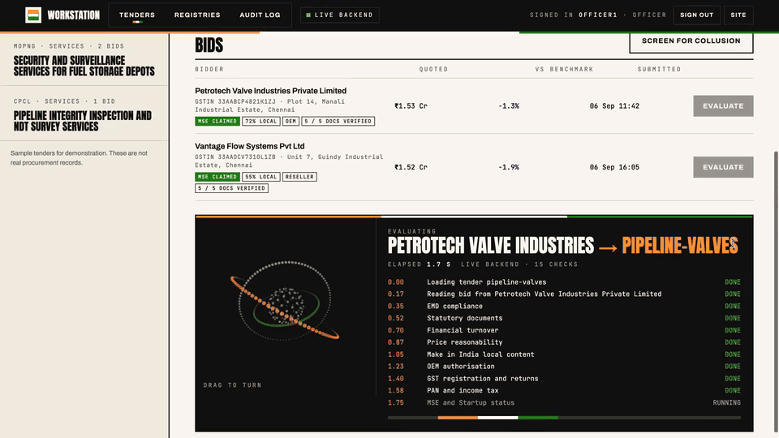

<p align="center">
  
</p>

# Procurement Pilot (SIH26100)

[](https://github.com/victorisaacchinta-eng/procurement-pilot-sih/actions/workflows/ci.yml)

Live: [procurement-pilot-sih.vercel.app](https://procurement-pilot-sih.vercel.app) · Demo video: [YouTube, 4:52](https://youtu.be/D4A3Fv-sczU)

A procurement officer checking a GeM bid today opens portal after portal: GST, income tax, MCA21, Udyam, EPFO, the
debarment list, then the bid documents themselves. It is slow, and two officers can reach two different answers on
the same bid. Procurement Pilot runs fifteen fixed checks on every bid against ten registry sources, scores it out of
100 with a risk level, explains each flag in plain language, and leaves the decision and the signature to a named
officer.

We are Team Ace Azael (ACE Engineering College, Hyderabad) and we built this for Smart India Hackathon 2026, problem
statement SIH26100 from the Ministry of Petroleum and Natural Gas.

> [!NOTE]
> Student prototype. Not an official government system and not affiliated with or endorsed by any ministry or PSU.
> All tenders, bids, registry records, GSTINs, PANs, CINs and Udyam numbers here are sample data, and every
> registry lookup is labelled simulated in the app.

<p align="center">
  <a href="https://youtu.be/D4A3Fv-sczU"></a>
</p>

<p align="center">
  
  <br><sub>Screens from the live build: Petrotech at 100, Vantage at 89, the document check, Trident at 45, a written override, the collusion screen and the audit log.</sub>
</p>

## How it works

<p align="center">
  
</p>

The fifteen checks are plain Python in `backend/app/checks.py`. Each one returns PASS, FLAG or FAIL with a sentence
naming the actual numbers and the source it checked, so the same bid always gets the same answer. Registry lookups go
through one adapter per source in `registry.py` (GSTN, Income Tax, MCA21, Udyam, DPIIT, NSIC, EPFO, ESIC, DigiLocker
and the GeM / CPPP debarment list). Going live means replacing one lookup function; the checks do not change.

On top of that:

- Upload a bid PDF and the document reader pulls the GSTIN, PAN, Udyam, CIN, DPIIT number and legal name from the
  text layer and cross-checks each against the bid.
- A reasoning layer (any OpenAI-compatible model; Sarvam's `sarvam-105b` in production) writes the explanation. It
  cannot set the score or the verdict, PAN and GSTIN are masked before anything reaches it, and without a key the app
  falls back to a deterministic summary and says so.
- The collusion screen compares every pair of bids on a tender: prices within 0.5%, submissions within 5 minutes,
  shared addresses, and cover bids more than 25% above the benchmark.
- Officer, senior approver and admin roles are enforced by the server. Passing a flagged bid
  needs a senior approver and a written reason of 30+ characters, and every decision lands in the audit log.

### The score

<p align="center">
  
</p>

The weights add up to 100. PASS earns the full weight, FLAG half, FAIL nothing. A FAIL on EMD, statutory documents,
GST registration or debarment caps the score at 45 and makes the risk Critical; any other FAIL caps it at 72 (High);
any FLAG makes it Medium; all PASS is Low. The workstation shows a "Why not 100" line with every point lost.

| Family | Check | Weight | Checked against |
|---|---|---:|---|
| Tender eligibility | EMD compliance (cap) | 10 | Bid record, Udyam / DPIIT / NSIC for exemptions |
|  | Statutory documents (cap) | 10 | DigiLocker |
|  | Financial turnover | 10 | Bid record |
|  | Price reasonability | 8 | Tender benchmark |
|  | Make in India local content | 6 | Bid declaration (Class-I 50%+, Class-II 20%+) |
|  | OEM authorisation | 6 | Bid declaration |
| Registry verification | GST registration and returns (cap) | 8 | GSTN, plus the real GSTIN check digit |
|  | PAN and income tax | 7 | Income Tax Department, PAN read from the GSTIN |
|  | MSE and Startup status | 6 | Udyam, DPIIT, NSIC |
|  | EPFO and ESIC compliance | 6 | EPFO, ESIC |
| Integrity and risk | Entity name consistency | 7 | Bid, documents, GSTN, PAN holder, MCA21 |
|  | Debarment status (cap) | 8 | GeM / CPPP debarment list |
|  | Public interest screening | 3 | Adverse media record |
|  | Shell company indicators | 3 | MCA21 incorporation date, shared addresses |
|  | Past performance history | 2 | This platform's own audit log |

"(cap)" means a FAIL there caps the score at 45. The rules that need no lookup are real: the GSTIN check digit, the
PAN inside the GSTIN with its holder-type and name codes, the Make in India class thresholds, EMD exemptions for
verified MSE, Startup and NSIC bidders, a one-month grace on EPFO / ESIC challans, and incorporation under 91 days as a
shell signal.

### SIH26100 outcomes

The problem statement asks for fourteen outcomes. Where each one is:

- 1, government portal integration: the `registry.py` adapters (sample data) and the Registries view
- 2 to 9 (Udyam/MSME, GST, PAN and income tax, Make in India, EPFO/ESIC, Startup India/NSIC/OEM, DigiLocker, debarment):
  one check each in the table above, plus the PDF reader for document verification
- 10, other statutory and tender-specific items: EMD, turnover and price checks, with spec gaps named by the reasoning layer
- 11, missing or inconsistent information: entity name across bid, documents, GSTN, PAN and MCA21
- 12 to 14, score and risk level, AI recommendation, auditable record: the score with "Why not 100", the reasoning
  layer, and the audit and access logs

## Run it

You need Python 3.11 or newer.

```bash
git clone https://github.com/victorisaacchinta-eng/procurement-pilot-sih.git
cd procurement-pilot-sih/backend
python3 -m venv .venv && source .venv/bin/activate
pip install -r requirements.txt
uvicorn app.main:app --reload
```

Open http://127.0.0.1:8000, press **Open workstation** and pick a demo account: `officer1` / `officer123`,
`approver1` / `approver123` (senior approver) or `admin1` / `admin123`. These are demo credentials; override them with
`DEMO_USERS` and set `JWT_SECRET` before any real use.

To turn on the reasoning layer, copy `.env.example` to `backend/.env` and set `LLM_API_KEY`. For Sarvam:
`LLM_BASE_URL=https://api.sarvam.ai/v1`, `LLM_MODEL=sarvam-105b`, `LLM_REASONING_EFFORT=none`. Any OpenAI-compatible
provider works the same way. Without a key every check still runs.

### Demo walkthrough

On Pipeline valves, Petrotech passes every check (100, risk Low) and Vantage gets 89 because GSTN, the PAN holder and
the documents all say "Vantage Flow Solutions Ltd"; the PDF reader under Document check finds the same mismatch. On
Refinery PPE, SafeGuard has no EMD but is a verified DPIIT startup, so the exemption holds (100), while Trident and Apex
both land at 45, Critical. **Screen for collusion** on Tanker transport flags Swift and Ratnagiri, quoted 0.38% apart
and 2 minutes apart. Marking Meridian (Depot security) as Qualified is refused for `officer1` and opens the
written-override box for `approver1`. Before a recording, sign in as `admin1`, open **Audit log** and press **Reset demo
data** twice.

## Tests

```bash
cd backend
pip install -r requirements-dev.txt
python -m pytest -q                      # 26 API tests on SQLite
TEST_DATABASE_URL=postgresql://... python -m pytest -q   # same suite on Postgres
cd .. && python scripts/dump_backend.py > /tmp/b.json && node scripts/parity_test.js /tmp/b.json
```

The last line runs the frontend's offline engine against the backend's results for every sample bid. CI runs both on
every push. If you change `backend/app/data.py`, `checks.py` or `collusion.py`, run `python scripts/sync_seed.py` so the
frontend's copy of the data stays identical.

## Deploy

Production is one Vercel project: FastAPI runs as a Vercel Function (`pyproject.toml` points at
`backend.app.main:app`) and `frontend/` is served from the CDN. Import the repo, add Neon under **Storage**
(that sets `DATABASE_URL` and the app switches from SQLite to Postgres), set a long random `JWT_SECRET` (every
function instance must share it or sign-ins fail at random), optionally add the `LLM_*` variables, and redeploy.
`GET /api/health` should then report `"database": "postgres"`. `render.yaml` is an alternative single-service deploy;
on Render's free plan the SQLite file is lost when it sleeps, so set `DATABASE_URL` there too.

If the API is unreachable, the frontend falls back to a built-in demo engine on the same sample data and labels it
"Demo engine". The API routes are listed at the top of `backend/app/main.py`.

## Limitations

- Tenders and bids are seeded. The document reader cross-checks a PDF against a seeded bid; it does not create new bids.
- Every registry lookup reads sample records and says so. The GSTIN check digit and PAN structure rules are real.
  Live access needs government onboarding (API Setu, a GST Suvidha Provider).
- Scanned PDFs need OCR, which is not in this build.
- Production runs on a free Neon Postgres. A real deployment needs a paid tier with backups and point-in-time restore.

Next for us: OCR for scanned bid PDFs, live GSTN and Udyam lookups through API Setu and a GST Suvidha Provider, and one
pilot with a CPSE procurement team.

## Licence

MIT, see [`LICENSE`](LICENSE). Built by Team Ace Azael, ACE Engineering College, Hyderabad, for Smart India Hackathon
2026 (SIH26100). Repository maintained by [Chintha Victor Isaac](https://github.com/victorisaacchinta-eng).
